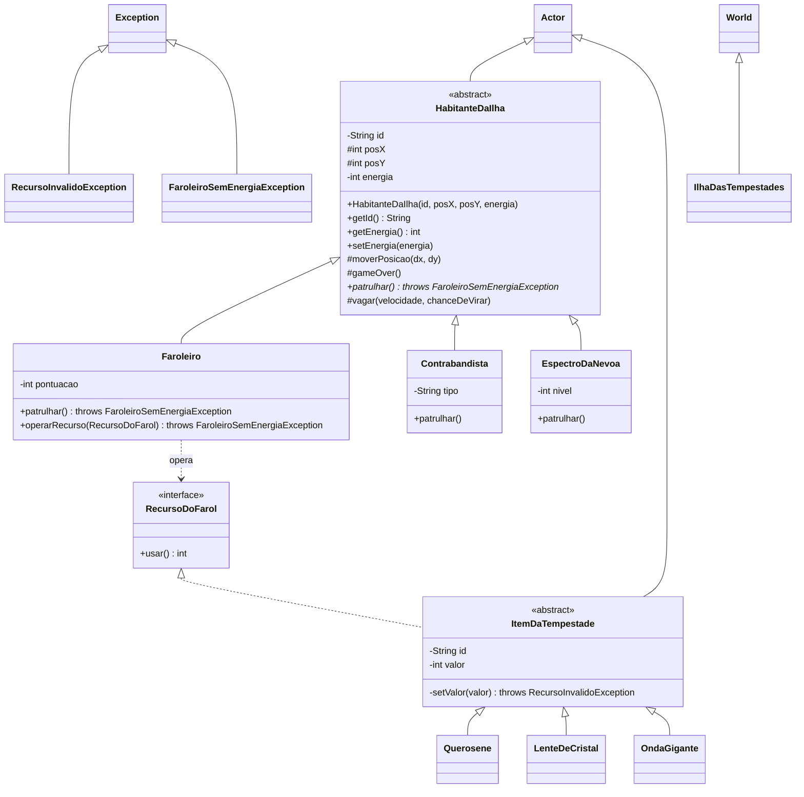

# greenfoot-exception — A Tempestade do Farol

Versão em **Greenfoot** do [Desafio 20 – A Tempestade do Farol](https://pages.s3lab.dpdns.org/leandro/2026-inf-poo/desafios/20_excecoes.html).
O ponto de partida é o jogo do Faroleiro da revisão ([molde](https://pages.s3lab.dpdns.org/leandro/2026-inf-poo/posts/17_revisao_molde.html),
[contrato](https://pages.s3lab.dpdns.org/leandro/2026-inf-poo/posts/18_revisao_contrato.html),
[onde isso quebra?](https://pages.s3lab.dpdns.org/leandro/2026-inf-poo/posts/19_revisao_onde_quebra.html)).
Toda "correção silenciosa" foi trocada por [exceções](https://pages.s3lab.dpdns.org/leandro/2026-inf-poo/posts/20_excecoes.html),
e as classes foram organizadas com a mesma
[mecânica de herança do tutorial do Greenfoot](https://pages.s3lab.dpdns.org/leandro/2026-inf-poo/posts/08_greenfoot.html#usando-heranca)
(`Decapoda` → `Crab`/`Lobster`).

## Como abrir e jogar

1. Abra a pasta do repositório no Greenfoot (*Scenario → Open*), que contém o `project.greenfoot`.
2. Clique em **Compile** e depois em **Run**.
3. Use as **setas** para guiar o Faroleiro (F1).

**Objetivo:** manter o farol aceso até o amanhecer (20 patrulhas).

- A cada ~2,5 s o Faroleiro **patrulha**: anda 1 casa para a direita, gasta 10 de energia e ganha 1 ponto.
- A tempestade traz recursos pelo mar:
  - **Querosene** (laranja): `usar()` devolve `+valor`;
  - **LenteDeCristal** (azul-claro): devolve `+2 × valor`;
  - **OndaGigante** (azul, vem da direita): devolve `-valor`.
- O valor de cada recurso é sorteado entre -5 e 25. Os inválidos (`<= 0`) são **recusados** com
  `RecursoInvalidoException` e aparecem no diário de bordo, embaixo da tela.
- O **Contrabandista** (C1) tenta sabotar o Faroleiro entregando uma `OndaGigante` com força
  sorteada. Se a força for inválida, a sabotagem falha (`RecursoInvalidoException`).
- O **Espectro da Névoa** (E1) entrega um "recurso feito de névoa": `operarRecurso(null)`, que é
  recusado com `IllegalArgumentException`.
- Quando a energia chega a 0 aparece `F1: fim de jogo!`. Qualquer tentativa seguinte de patrulhar
  ou operar um recurso lança `FaroleiroSemEnergiaException` e o jogo **termina de verdade**.
- Logo ao abrir, a ilha tenta criar F1 com energia **120** (a linha 1 da revisão). O construtor
  recusa, e o mundo decide, de forma visível no código, criar F1 com 100.

Tudo o que o jogo imprime (`IO.println`) vai para o terminal do Greenfoot e para o diário de bordo.

### O roteiro de 11 linhas (Main)

A classe `Main` mantém a sequência da revisão com os mesmos valores. Para executá-la no Greenfoot:

- clique com o botão direito na classe **Main** → `void main(String[] args)`; ou
- clique com o botão direito no mundo → `executarRoteiroDaRevisao()`.

## Estrutura das classes



| Classe | Papel |
|---|---|
| `HabitanteDaIlha` | Molde abstrato (como `Decapoda`): id, posição, energia, `setEnergia`, `moverPosicao`, `gameOver` e o comportamento comum `vagar`. |
| `Faroleiro`, `Contrabandista`, `EspectroDaNevoa` | Filhas (como `Crab`/`Lobster`): passam os dados para `super(...)` e cada uma tem o seu `patrulhar()`. |
| `RecursoDoFarol` | O contrato `int usar()`. |
| `ItemDaTempestade` | Molde abstrato dos recursos: guarda `id`/`valor` e valida em **um só** `setValor`, que lança `RecursoInvalidoException`. Também cuida do tempo do recurso no mar. |
| `Querosene`, `LenteDeCristal`, `OndaGigante` | Cada recurso só diz o seu `usar()` e a sua imagem. Os construtores declaram `throws RecursoInvalidoException`. |
| `RecursoInvalidoException`, `FaroleiroSemEnergiaException` | Exceções **verificadas** (`extends Exception`). |
| `IlhaDasTempestades` | O mundo: cria os habitantes, traz os recursos da tempestade, mostra placar/diário e encerra o jogo. |
| `Painel`, `IO` | Placar, diário de bordo e aviso final; `IO.println` imprime no terminal e no diário. |
| `Main` | O roteiro de 11 linhas da revisão com `try/catch/finally`. |

> **Sobre o `setValor`:** no código da revisão cada recurso repetia o mesmo `setValor`. Seguindo a
> mecânica de herança do tutorial, a validação foi para `ItemDaTempestade`, e os três recursos a
> herdam. A regra pedida continua: nenhum recurso troca mais um valor inválido por 1, e o
> construtor de cada um declara `throws RecursoInvalidoException`.

### Requisitos do desafio

- [x] Construtor de `HabitanteDaIlha` lança `IllegalArgumentException` para energia fora de 1..100 (`"Energia inválida para F1: 120"`). A regra de jogo de `setEnergia` continua valendo durante a partida.
- [x] `RecursoInvalidoException extends Exception`, com construtor que repassa a mensagem para `super`.
- [x] `setValor` lança `RecursoInvalidoException` (`"Valor inválido para o recurso L1: -4"`) em vez de usar 1.
- [x] Construtores dos recursos declaram `throws RecursoInvalidoException`.
- [x] `operarRecurso(null)` lança `IllegalArgumentException("Recurso ausente para operar.")`.
- [x] `FaroleiroSemEnergiaException extends Exception`, lançada por `operarRecurso` com energia 0, sem alterar a energia.
- [x] `Main` (e o jogo) com `try/catch` específicos (sem `catch (Exception e)`) e `finally`.
- [x] O programa executa até a linha 11.
- [x] Desafio extra: `patrulhar()` também lança `FaroleiroSemEnergiaException`.

## Respostas das questões

### 1. Saída completa do `Main` depois das alterações

```text
Habitante recusado: Energia inválida para F1: 120
Main decide: F1 será criado com energia 100.
Recurso recusado: Valor inválido para o recurso L1: -4
F1 patrulha o farol
F1 está com energia 90
F1 está com energia 20
Operação recusada: Recurso ausente para operar.
F1 está com energia 20
Operação recusada: Recurso ausente para operar.
F1 está com energia 20
F1: fim de jogo!
F1 está com energia 0
O farol está sem energia suficiente para continuar.
F1 está com energia 0
F1 termina com energia 0
```

### 2. Comparação com a saída da revisão

Saída da revisão (antes das exceções):

```text
F1 patrulha o farol
F1: fim de jogo!
F1 termina com energia 15
```

| Linha | Antes | Depois |
|---|---|---|
| 1 (`energia 120`) | `setEnergia` trocava 120 por 100 em silêncio; quem criou não ficava sabendo. | O construtor lança `IllegalArgumentException("Energia inválida para F1: 120")`. O `Main` captura, informa e **ele mesmo** decide criar F1 com 100, e essa decisão fica visível no código. |
| 3 (`LenteDeCristal -4`) | `setValor` trocava -4 por 1; a lente existia e na linha 7 dava +2 de energia (20 → 22). | `setValor` lança `RecursoInvalidoException("Valor inválido para o recurso L1: -4")`; a lente não é criada e `l` fica `null`. |
| 8 (`operarRecurso(null)`) | O `if (recurso != null)` ignorava a chamada: parecia que "funcionou", mas nada acontecia. | `operarRecurso` lança `IllegalArgumentException("Recurso ausente para operar.")` e o `Main` informa "Operação recusada". |
| 9 (onda de 70) | A energia ia para -48, era fixada em 0 e aparecia `F1: fim de jogo!`. | O mesmo (é a regra de jogo de `setEnergia`): 20 - 70 → 0 e `F1: fim de jogo!`. |
| 10 (querosene depois do fim) | F1 voltava a ganhar energia (0 + 15 = 15): o jogo continuava depois de terminar. | `operarRecurso` lança `FaroleiroSemEnergiaException("O farol está sem energia suficiente para continuar.")` e a energia **não** muda. F1 termina com 0. |

### 3. Por que `LenteDeCristal` precisou de `throws` e `HabitanteDaIlha` não?

Porque os dois lançam tipos diferentes de exceção:

- `RecursoInvalidoException extends Exception` é uma exceção **verificada** (*checked*). O
  compilador obriga quem pode lançá-la a declarar `throws` na assinatura (no `setValor` e no
  construtor que chama `setValor`) e obriga quem chama a tratar com `try/catch` ou repassar.
- `IllegalArgumentException` é subclasse de `RuntimeException`, uma exceção **não verificada**
  (*unchecked*). O compilador não exige `throws` nem `try/catch`. Mesmo assim, o `Main` a trata,
  porque sabe o que fazer (criar com 100).

### 4. Na linha 7, `l` vale `null`. Qual exceção é lançada e por quem? Faz sentido?

É lançada uma `IllegalArgumentException` com a mensagem `"Recurso ausente para operar."`, pelo
método **`Faroleiro.operarRecurso`**, porque o recurso recebido é `null`. Faz sentido: o método
não tem como operar algo que não existe e avisa quem chamou, em vez de ignorar. A causa real,
porém, está na linha 3, onde a lente foi recusada. A exceção da linha 7 é uma **consequência**
de o `Main` ter seguido em frente com `l == null`. Como quem trata é o `Main`, ele poderia também
decidir não operar a lente (`if (l != null)`), já que sabe que ela não foi criada.

### Desafio extra: `patrulhar()` respeitando o fim de jogo

Ao fazer `Faroleiro.patrulhar()` lançar `FaroleiroSemEnergiaException`, o compilador reclama:
*"overridden method does not throw FaroleiroSemEnergiaException"*. Um método sobrescrito **não
pode lançar exceções verificadas que o método original não declara**, senão quem usa um
`HabitanteDaIlha` sem saber que é um `Faroleiro` seria surpreendido por uma exceção que o contrato
não anunciava.

**Escolha: opção (a)**, declarar `throws FaroleiroSemEnergiaException` no método abstrato de
`HabitanteDaIlha`. Justificativa:

- O contrato passa a avisar que patrulhar pode falhar por falta de energia, e toda a família tem
  energia e `gameOver()`.
- `Contrabandista` e `EspectroDaNevoa` **não são obrigados** a repetir o `throws`: quem sobrescreve
  pode lançar *menos* exceções que o molde. Por isso nada muda no código deles, e quem os chama
  pelo tipo concreto (como o `act()` de cada um) não precisa de `try/catch`.
- Só quem chama `patrulhar()` por uma referência `Faroleiro` ou `HabitanteDaIlha` precisa tratar,
  e é justamente aí que o fim de jogo importa (o `act()` do Faroleiro e a linha 5 do `Main`).

O custo é o nome da exceção, que fala de "Faroleiro" num método do molde. Uma alternativa seria
uma exceção mais geral (por exemplo `HabitanteSemEnergiaException`) da qual
`FaroleiroSemEnergiaException` fosse filha.

## Onde as exceções são tratadas no jogo

Na versão de console, "os métodos do jogo lançam e o `Main` trata". No Greenfoot, o papel do
`Main` fica com os métodos `act()`, que são chamados a cada passo da simulação:

| Quem lança | Exceção | Quem trata (catch) | O que faz |
|---|---|---|---|
| construtor de `HabitanteDaIlha` | `IllegalArgumentException` | `IlhaDasTempestades.prepare()` | Cria F1 com energia 100. |
| construtores dos recursos (`setValor`) | `RecursoInvalidoException` | `IlhaDasTempestades.trazerRecurso()` e `Contrabandista.sabotar()` | Recusa o recurso e registra no diário. |
| `Faroleiro.operarRecurso(null)` | `IllegalArgumentException` | `EspectroDaNevoa.assombrar()` | "Operação recusada"; `finally` mostra a energia de F1. |
| `Faroleiro.operarRecurso` / `patrulhar` com energia 0 | `FaroleiroSemEnergiaException` | `Faroleiro.act()`, `Contrabandista`, `EspectroDaNevoa` | Encerra a partida (`IlhaDasTempestades.encerrar`). |
